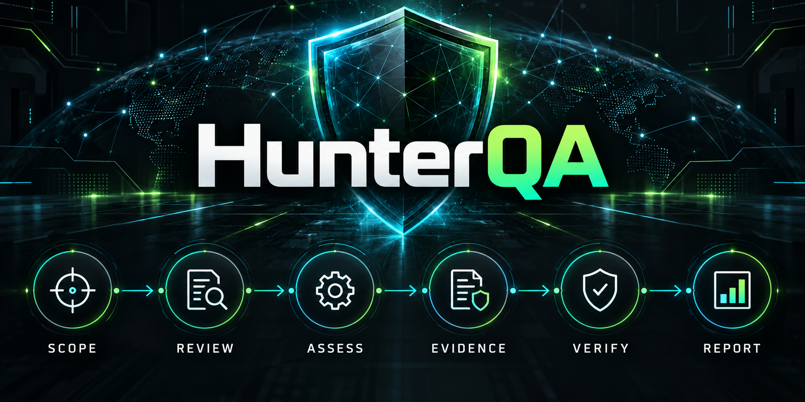

# HunterQA



HunterQA is a local workspace for authorized security assessments. Review code
and saved evidence, run selected checks within an approved scope, and produce
reports you can review and retest. It is designed for a single operator.

**Python 3.11+ · Kali/Linux recommended · CLI and local dashboard**

[Zero to Start](<zero to start.md>) ·
[Beginner’s assessment guide](docs/AUTHORIZED_ASSESSMENT_BEGINNER_GUIDE.md) ·
[Templates](templates/README.md) · [Category index](docs/CATEGORY_REVIEW_INDEX.md)

## Is it ready?

**Ready for supported local review workflows and the built-in owned lab.** It is
still a development platform, not a complete autonomous pentesting system or a
production multi-user service. Giving it a URL does not run every vulnerability
test or prove that a website is secure.

The package version remains **1.3.0**. Current `main` includes later development
features absent from the original [v1.3.0 release](https://github.com/ManeaAl-Shabrain/HunterQA-AI/releases/tag/v1.3.0).
Use current source for this guide. Record `git rev-parse HEAD` with your evidence;
the version number alone does not identify the installed features.

## Available capabilities

| Capability | Implemented today |
| --- | --- |
| Source/configuration review | Selected built-in checks; optional Semgrep and local Ollama suggestions |
| Web observations | Scoped HEAD/GET and HTML discovery; opt-in same-origin HTTPS JavaScript/cookie-session discovery |
| Owned browser lab | Optional JavaScript-rendered links and local login context, restricted to owned loopback |
| Owned SQL lab | Eight fixed in-memory impact/control cases and deterministic evidence replay |
| Validation cues | Fixed inert-markup and SQL-error comparisons; explicit role/anonymous access contracts |
| Infrastructure/cloud | Exact TCP connectivity; selected read-only AWS account checks with the cloud extra |
| Saved evidence review | Selected API, identity, cloud, container, network and other artifact readers |
| Category packs | 23 categories and 79 catalog entries, with implemented modes in the category index |
| Workflow controls | Scope checks, approvals, budgets, timeouts, stop requests and optional host-local shared quotas |
| Reporting | Analyst review, HTML/JSON/SARIF exports, retest comparison, report-quality checks and CVSS 3.1 Base arithmetic |
| Dashboard | Local workflow/evidence views; optional viewer, analyst and admin accounts |

Catalog entries include guided and declaration-based reviews. They are not 79
automated attack modules. Saved settings and scanner candidates need independent
review; neither confirms exploitability by itself.

## Install and try the lab

On Kali/Linux:

```bash
git clone https://github.com/ManeaAl-Shabrain/HunterQA-AI.git
cd HunterQA-AI
python3 -m venv .venv
source .venv/bin/activate
python -m pip install --upgrade pip
python -m pip install -e .
hunterqa --version

umask 077
mkdir -p "$HOME/hunterqa-private"
chmod 700 "$HOME/hunterqa-private"
export HUNTERQA_APPROVED_ROOTS="$HOME/hunterqa-private"
export HUNTERQA_LAB="$HOME/hunterqa-private/lab-$(date +%Y%m%d-%H%M%S)"
hunterqa assessment-benchmark --out-dir "$HUNTERQA_LAB" --authorized
hunterqa assessment-readiness --benchmark-dir "$HUNTERQA_LAB" --require-owned-lab
```

The lab starts and closes its own `127.0.0.1` service. It tests eight labeled
application cases and three discovery/TCP controls across four workflows, keeping
evidence in your private directory. It accepts no external target. A normal run
records 18 network operations. Passing establishes only this fixture baseline,
not general exploitability or real-world effectiveness.

[Zero to Start](<zero to start.md>) covers Windows, expected results, reports and
troubleshooting. Use a fresh output directory for each run.

## What remains incomplete

All seven broad assessment areas remain **partial**. Rendered discovery supports
bounded same-origin anchors and conventional cookie login; general authenticated crawling,
comprehensive active vulnerability validation, SSO and
business workflows, OS/AD attack paths, broad multi-cloud permissions, hosted
tenant isolation, independently verified owner grants, OS isolation and
distributed enforcement. Real-world detection effectiveness is **unverified**.

The SQL lab is a separate in-memory fixture; it does not validate the HTTP
SQL-error scanner or establish customer findings. See the [SQL lab guide](docs/OWNED_SQL_VALIDATION.md).

See the [feature checklist](docs/FEATURE_READINESS_CHECKLIST.md) before choosing
an engagement. Authorization does not enable missing functionality.

## Guides

| Need | Read |
| --- | --- |
| First approved assessment | [Beginner’s guide](docs/AUTHORIZED_ASSESSMENT_BEGINNER_GUIDE.md) and [templates](templates/README.md) |
| CLI commands and execution modes | [Command reference](docs/COMMAND_REFERENCE.md) |
| Rendered discovery and reference recall | [Scoped browser guide](docs/SCOPED_RENDERED_DISCOVERY.md) |
| Expansion status | [Seven-area progress](docs/EXPANSION_PROGRESS.md) |
| Workflow planning/approvals | [Workflow runner](docs/WORKFLOW_RUNNER.md) |
| Adapters and shared quotas | [Adapter guide](docs/ASSESSMENT_ADAPTERS.md) |
| Lab evidence and readiness | [Readiness](docs/READINESS.md) |
| Dashboard accounts | [Operator access](docs/OPERATOR_ACCESS.md) |
| All category guides | [Category index](docs/CATEGORY_REVIEW_INDEX.md) |
| Report quality/scoring | [Utility guide](docs/UTILITY_REVIEW.md) |
| Release packaging/version policy | [Versioning](docs/VERSIONING.md) |
| Releases/security reports | [Releases](https://github.com/ManeaAl-Shabrain/HunterQA-AI/releases) and [security policy](SECURITY.md) |

Use only systems you own or have explicit written permission to assess, within
the agreed scope. Keep completed templates, credentials and client evidence
outside this repository. `--authorized` records your acknowledgement; it does not
verify ownership or replace written approval.
